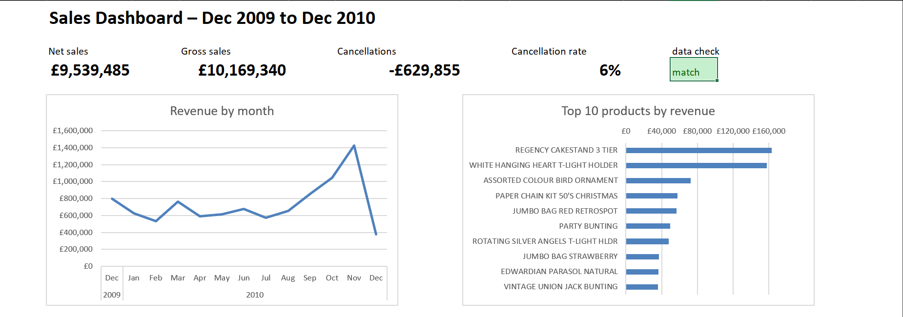

# Sales Health Check – UK Online Gift Retailer (Excel)

**Business question:** Why did revenue fall 15% in July 2010, and what does the business look like overall?

**Answer:** Revenue fell from £679,787 to £575,236 because the business received **17% fewer orders**, not smaller ones (the average sale stayed at about £17). **88% of the drop came from UK customers**, and the dip did not repeat in July 2011, so it was a one-off problem rather than normal seasonality.

## Data
- **Source:** [Online Retail II, UCI Machine Learning Repository](https://archive.ics.uci.edu/dataset/502/online+retail+ii)
- **Size:** 525,461 sales lines (Dec 2009 – Dec 2010) plus 541,910 lines (Dec 2010 – Dec 2011)
- **Columns:** Invoice, StockCode, Description, Quantity, InvoiceDate, Price, Customer ID, Country
- The raw Excel files are too large for GitHub (over 100 MB); download them from the link above.

## Tools
Excel: SUMIFS, COUNTIFS, AVERAGEIFS, IF/IFS, XLOOKUP/VLOOKUP, IFERROR, text and date functions, pivot tables and pivot charts, Power Query, conditional formatting.

## Process
1. **Profiled the data** and logged 8 data-quality problems: 107,927 missing Customer IDs, 10,206 cancellation lines, 6,865 duplicate rows, £0 prices, extra spaces in about 99,600 descriptions, and non-product rows such as postage, fees and manual adjustments.
2. **Added calculated columns:** Revenue, Cancelled, Order size, Month, Region (lookup table of 40 countries), Year, Day, Hour and a cleaned description.
3. **Analysed** revenue by month, region, day, hour and product with SUMIFS and pivot tables, and found the July drop and its causes.
4. **Automated the cleaning** in Power Query so the next year's file (541,910 rows) is cleaned with one click: 5,268 duplicates removed, 536,642 rows loaded.
5. **Reconciled the totals:** gross sales £10,169,340 + cancellations −£629,855 = net sales £9,539,485, matching every report, with an automatic Match/Check status.
6. **Built a one-page dashboard** and wrote a findings memo for the manager.

## Key findings
| Finding | Evidence |
|---|---|
| July 2010 drop was fewer orders, mostly UK | Sales lines −17%, average line ~£17, UK −£91,896 |
| The business depends on the UK | UK = 86% of revenue, Europe = 13% |
| Sales peak in October–November | November 2010 = £1.42m as shops stock up for Christmas |
| Busiest times | Thursday, 12 noon to 1 pm; Saturday almost no sales |
| Top product is also the most cancelled | Regency Cakestand: £163k sales, 4.3% cancelled vs 1.8% for a similar product |
| Not all "cancellations" are products | £277k of manual adjustments plus Amazon fees and bank charges, flagged for finance |

## Recommendations
- Contact UK customers who ordered in June 2010 but not July to find out why.
- Check July 2010 for stock shortages, website problems or price changes.
- Track monthly order counts by country on the dashboard to spot drops early.

## Files
- `README.md` – this summary
- `Findings_Memo.pdf` – one-page memo for the manager
- `dashboard.png` – the Excel dashboard

---
*Sai Jitendra Kodamasimham · MSc Computer Science · London*
